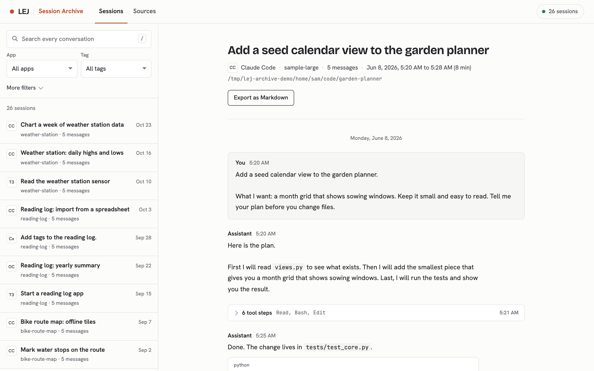
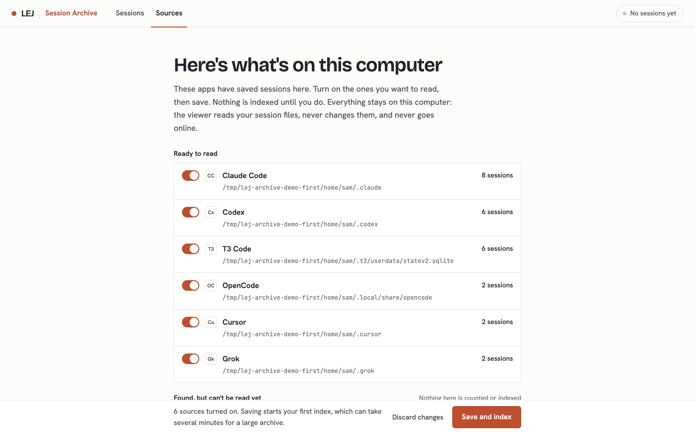
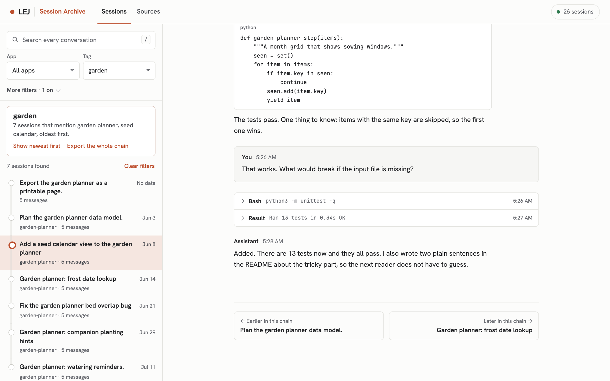
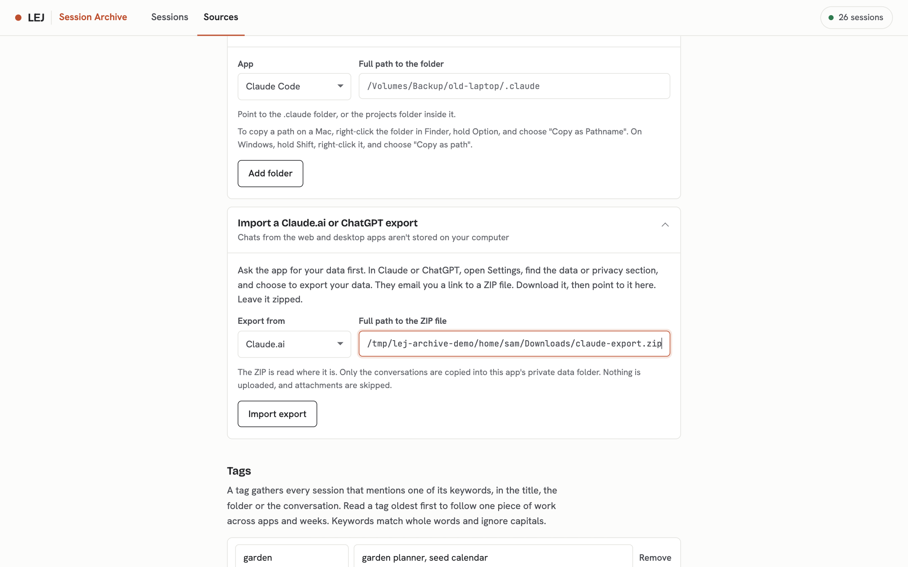

# LEJ AI Session Archive Viewer

Every conversation you've had with an AI coding tool, in one place you can search and read. It runs on your computer and stays there.



You've done months of work in Claude Code, Codex, T3 Code, Cursor and the rest. Each app keeps its own history in its own format, and most of it is hard to get back to. This viewer reads those histories where they already live and gives you one list, one search box and one clean page to read.

- **Find it.** Search a phrase across every conversation and every tool step. Narrow by app, folder, date or tag.
- **Read it.** Your turns and the assistant's turns, with tool steps folded out of the way until you want them.
- **Follow it.** Tag a piece of work by keyword, then read it oldest first as a chain across apps and weeks.
- **Keep it.** Export one session, or a whole chain, as Markdown.

Nothing leaves your machine. There is no account, no API key, no cloud and no telemetry. Your session files are read and never changed.

## Start

You need Python 3.10 or newer. There is nothing to install and nothing to build.

Download or clone this repository, open a terminal in that folder, and run:

| | |
| --- | --- |
| **Mac** | `python3 viewer.py` |
| **Windows** | `py -3 viewer.py` |

Then open **http://127.0.0.1:8765** in your browser. Press Ctrl-C in the terminal to stop. If the port is taken, add `--port 8766`.

The first screen shows what the viewer found on your computer. Turn on the apps you want and choose **Save and index**. Nothing is indexed until you do. A large archive takes several minutes the first time. You can start reading while it runs, and the bar at the top tells you how far along it is.



### Set it up with your agent

Don't want to do it by hand? Paste this into Claude Code, Codex, Cursor or any coding agent, from this folder:

> Set up LEJ AI Session Archive Viewer from this repository. Read AGENTS.md, check Python, start it locally, and give me the URL. Don't change my session files, and keep all session data out of Git.

The agent's steps are in [AGENTS.md](AGENTS.md).

### Try it with made-up data first

```
python3 tools/demo.py
```

This builds a pretend home folder full of sample sessions and opens the viewer on it at http://127.0.0.1:8799. It never touches your real data. Add `--first-run` to see the first screen as a new user would. Every screenshot in this repository comes from this demo.

## What it reads

| App | What the viewer reads |
| --- | --- |
| Claude Code | `.claude/projects/**/*.jsonl`, including helper files |
| Codex | Versioned `thread_history_*.sqlite` and `state_*.sqlite`; active and archived JSONL, legacy JSON and `.jsonl.zst`; `history.jsonl` |
| T3 Code | `.t3/userdata/statev2.sqlite`: messages, tool steps and parent/child links |
| OpenCode | `opencode.db` (both schema generations) and the legacy `storage/` JSON tree |
| Cursor | `.cursor/projects/**/*.jsonl` transcript files |
| Grok CLI | `.grok/sessions/**/chat_history.jsonl` with its summary metadata |
| Claude.ai and Claude desktop | An official export ZIP that you import |
| ChatGPT | An official export ZIP that you import |
| Gemini CLI, Antigravity, Cursor's app database | Found and shown, but not readable yet |

A source shows up because its files are on disk, not because the app is installed. When the viewer finds a folder it can't read, it says so and claims no count.

Chats from Claude.ai and ChatGPT live on their servers, so there is nothing local to read, even with the desktop app installed. Ask the app for a data export and import the ZIP (see below).

OpenRouter is an API with no history of its own. Its traffic shows up under whichever app made the call.

Good to know:

- **Counts are records, not unique conversations.** If two apps recorded the same work, you see both.
- **Codex** keeps a database and files. The database wins when both hold the same session. Your typed-prompt history shows up as one extra transcript.
- **Cursor's** transcript files carry no timestamps, so those sessions show no date.
- **Compressed Codex archives** (`.jsonl.zst`) need Python 3.14, or the `zstandard` package (`python3 -m pip install zstandard`), or a `zstd` program on your PATH. Without one, those files are skipped with a warning.

## Read and organize



**Search** looks for your exact words or phrase in messages and tool steps. Matches are highlighted, and **Next match** walks through them.

**Tool steps stay folded.** A run of them collapses to one line, like "6 tool steps". Open a step to see the command and its output, and open "Full record" for the raw data.

**Related sessions link up.** When one session hands work to another (T3 Code, Codex and OpenCode record this), you get "Started from" and "Handed off to" links at the top.

**Tags** are how you follow one piece of work. On the Sources screen, give a tag a name and a few keywords:

| Tag | Keywords |
| --- | --- |
| garden | garden planner, seed calendar |

Every session that mentions a keyword in its title, folder or conversation gets the tag. Keywords match whole words and ignore capitals. Pick the tag in the list, choose **Read as a chain, oldest first**, and you can read the whole story in order. **Export the whole chain** saves it as one Markdown file.

**Text stays text.** Session content is never run or rendered as a web page. Headings, bold and code blocks get light formatting, and that's all. Images and attachments are left out. Nothing is fetched.

Keys: `/` to search, `J` and `K` for the next and previous session, arrow keys to move through the list.

## Bring in more



### Claude.ai and ChatGPT exports

In Claude or ChatGPT, open Settings, find the data or privacy section, and ask to export your data. They email you a link to a ZIP. Download it, leave it zipped, and paste its full path into **Import a Claude.ai or ChatGPT export** on the Sources screen.

The ZIP is read where it sits. Only `conversations.json` is used (up to 512 MB), and a copy of the conversations goes into this app's private data folder. Nothing is uploaded, attachments are skipped, and importing the same export twice won't make duplicates. Branched ChatGPT answers are all kept, in time order.

### Folders from another computer

Use **Add a folder** for session data you copied from another machine, or keep somewhere unusual. Pick the app and paste the full path:

| App | Point to |
| --- | --- |
| Claude Code | The `.claude` folder, or its `projects` folder |
| Codex | The `.codex` folder, the one with `sessions` and `archived_sessions` |
| T3 Code | The `statev2.sqlite` file itself |
| OpenCode | The data folder with `opencode.db` or `storage` |
| Cursor | The `.cursor` folder, or its `projects` folder |
| Grok | The `.grok` folder |

You can add as many as you like. Folder names inside those sessions are shown as labels; the folders don't need to exist on this computer.

When you copy a SQLite database, copy its matching `-wal` file too, with the app closed. A database copied alone from a running app can be missing its newest messages.

### Where it looks by default

Your own account's home folder: `.claude`, `.codex`, `.t3`, `.cursor`, `.grok`, `.gemini` and `.local/share/opencode`, plus Cursor's app-support folder. On Windows that means `%USERPROFILE%`, `%APPDATA%` and `%LOCALAPPDATA%`. Linux paths resolve too, but only Mac and Windows have been checked.

WSL homes are not searched. Add one as a folder, for example `\\wsl.localhost\Ubuntu\home\you\.codex`.

## Private by default

- **Read-only.** Your session files are never edited. Live databases are never even opened: the viewer copies the database and its WAL file as plain files, and reads only that private copy. It takes no lock, so your apps can stay open.
- **Local only.** The server listens on 127.0.0.1 and nowhere else. It rejects requests from other hosts and other sites. It makes no network calls: no telemetry, no CDN, no remote fonts. Everything it needs ships in this folder.
- **Kept apart.** The index, database copies, settings and imported exports live in your per-user app data, never in this folder:
  - Mac: `~/Library/Application Support/lej-ai-session-archive-viewer`
  - Windows: `%LOCALAPPDATA%\lej-ai-session-archive-viewer`
  - Linux: `$XDG_DATA_HOME/lej-ai-session-archive-viewer` (default `~/.local/share`)

  Use `--data-dir` to put it somewhere else, outside this folder and outside your sources.

Be clear-eyed about one thing: the index holds your conversations, and those can hold secrets. Keep it on an encrypted disk and out of shared or synced folders. Markdown exports include tool details. The viewer does not redact anything.

Turning a source off removes it from search the next time the index is rebuilt. Its database copy, and any imported export, stay in app data until you delete that folder (stop the viewer first).

## When something's off

**It won't start.** Run `python3 --version` (Windows: `py -3 --version`). You need 3.10 or newer; get it from python.org. An error about FTS5 means your Python's SQLite was built without full-text search, and you need a different Python build.

**"Address already in use."** Add `--port 8766`.

**New sessions aren't showing.** The index doesn't update by itself. Click the status in the top right, then **Rebuild the index**. A rebuild starts from scratch, so search is incomplete until it finishes.

**A source says "Not supported yet."** The folder is there, but this version can't read that format. If it's an app in the table above, the app may have changed how it saves sessions. Open an issue with the app version and the table or field names. Please don't attach private transcripts.

**"A file had a problem."** Usually an unfinished last line in a session that's still running. The rest of the index is fine.

**A database "kept changing."** An app was writing while the viewer copied its database. Rebuild during a quiet moment.

**Disk space.** Plan for a few GB with a large archive, for the index and the database copies.

Settings also live in `config.json` in the app data folder. Stop the viewer before editing it by hand.

## Development

```
python3 -m unittest discover -s tests -v
```

On Windows use `py -3`. The tests build made-up stores in temporary folders and never touch real data. CI runs them on Mac and Windows.

- [SPEC.md](SPEC.md): what the archive promises
- [docs/verification.md](docs/verification.md): what was checked, and the limits
- [docs/testing-runbook.md](docs/testing-runbook.md): how to retest
- [docs/design/](docs/design/): design notes and before-and-after screenshots

The interface is plain HTML, CSS and JavaScript in `static/`, with no build step. Colors, type and spacing are CSS variables at the top of `static/style.css`. The fonts (Bricolage Grotesque, Hanken Grotesk and JetBrains Mono) ship in `static/fonts/` under the SIL Open Font License; their license files sit beside them.

## License

MIT, copyright Limited Edition Jonathan. See [LICENSE](LICENSE).
